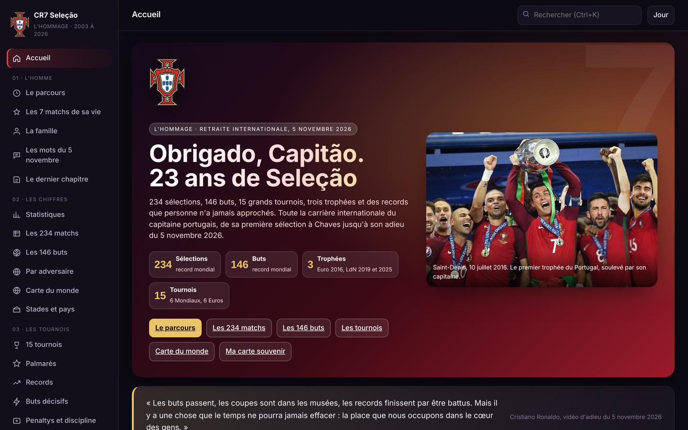

# CR7 Seleção

**L'hommage à la carrière internationale de Cristiano Ronaldo avec le Portugal, du 20 août 2003 au 5 novembre 2026.**

Application web autonome en un seul fichier, en français, thème jour et nuit, pensée pour le téléphone comme pour l'ordinateur.

Application en ligne : https://abdoulhamiddiallo.github.io/cr7-selecao/

## 📸 Aperçu

## 🏆 Chiffres clés

- 234 sélections, record mondial
- 146 buts, record mondial
- 142 victoires avec le Portugal, record mondial
- 3 trophées : Euro 2016, Ligue des nations 2019 et 2025
- 15 grands tournois : 6 Coupes du monde, 6 Euros, 2 phases finales de Ligue des nations, 1 Coupe des confédérations
- 10 coups du chapeau, 49 nations battues par au moins un but, 76 nations affrontées
- 22 penaltys transformés, 1 seul carton rouge en 23 ans

## 💡 Ce que l'application apporte

Un hommage complet, vérifié et interactif, publié le jour de sa retraite internationale : le message d'adieu traduit, les 21 hommages du jour, puis l'intégralité de la carrière, match par match et but par but, avec des visualisations que l'on ne trouve dans aucune autre ressource (machine à remonter le temps, mur des 146 buts, carte du monde des nations affrontées, dossiers par adversaire, film plein écran, carte souvenir à télécharger).

## 📋 Résumé

Le 5 novembre 2026, Cristiano Ronaldo annonce dans une vidéo de cinq minutes qu'il rend le maillot numéro 7 du Portugal. CR7 Seleção raconte ces 23 années en 24 chapitres : le parcours de Funchal à Arlington, les 7 matchs de sa vie, la famille, les mots du 5 novembre, le dernier chapitre, les statistiques, les 234 matchs, les 146 buts, les adversaires, la carte du monde, les stades, les 15 tournois, le palmarès, les records, les buts décisifs, les penaltys et la discipline, l'argent et les primes, les coups du chapeau, les comparaisons avec les légendes, le film, la carte souvenir, le quiz et les sources.

## 🔄 Chaîne de données

1. Liste officielle des 146 buts internationaux (date, sélection, stade, adversaire, score, compétition, penalty).
2. Résultats du Portugal année par année (2003 à 2026) pour reconstituer les 234 sélections, recoupés avec les numéros de sélection des 146 buts et le total officiel de 142 victoires.
3. Feuilles de match des 15 grands tournois (65 matchs) et de la Coupe du monde 2026.
4. Barèmes UEFA et FIFA pour les dotations, presse portugaise pour les primes.
5. Retranscriptions de la vidéo du 5 novembre 2026 et réactions publiées le jour même.

## 🧭 Traçabilité

Chaque page cite ses sources dans le chapitre « Sources et méthode ». Les séances de tirs au but comptent comme match nul au score ; « domicile » désigne un match joué au Portugal.

## 🏗️ Architecture

- Un seul fichier `index.html` (3,3 Mo) : données, photos, bibliothèques et logique embarquées, aucune dépendance au chargement (les drapeaux sont chargés en ligne avec repli automatique en emoji).
- Navigation par ancres, 24 pages rendues à la volée, recherche globale (Ctrl+K), thème jour et nuit mémorisé.
- Carte du monde vectorielle (Natural Earth, TopoJSON) avec zoom, choroplèthe à trois modes.
- Carte souvenir générée en canvas (1080 × 1350) et livre d'or conservé sur l'appareil du visiteur.

## 🛠️ Technologies

HTML, CSS, JavaScript ; Chart.js 4 ; D3 7 et topojson-client pour la carte ; Playwright pour les contrôles de rendu ordinateur et téléphone.

## ✅ Conclusion

Une seule adresse pour toute la carrière internationale de Cristiano Ronaldo, du premier match à Chaves au message d'adieu, avec des chiffres recoupés et une mise en scène digne du capitaine.

## 🙏 Mot de la fin

Obrigado, Capitão.

Conçu par Abdoul Hamid Diallo.
